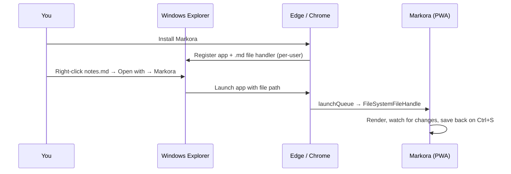

<div align="center">


# Markora


*Read and write Markdown the way AI chats render it. Install it once, right-click any `.md` file → **Open with → Markora**, and it opens in a clean Claude-style or ChatGPT-style reader with a live editor beside it.*

[**Live app**](https://markora.vercel.app) •
[**Features**](#features) •
[**How "Open with" works**](#how-open-with-works) •
[**Architecture**](#architecture) •
[**Running it locally**](#running-it-locally) •
[**Deployment**](#deployment)

<br />

<!-- Add a screenshot or GIF here — it's the single biggest upgrade a README can get:

-->

</div>

---

## Why

Most Markdown previews look like a 2009 wiki page. The best-looking Markdown most people see every day is inside AI chat apps, so Markora borrows that reading experience and makes it a proper desktop app for your own files. It has no backend and no account. Your files never leave your machine.

## Features

<table>
<tr>
<td width="50%" valign="top">

### Reading
- **Two styles**: *Claude* (serif, warm paper, clay accent) or *ChatGPT* (sans-serif, clean white or graphite)
- **Themes**: light, dark, or follow the system
- **Rendering**: GFM tables, task lists and reference-style links
- **Code**: syntax highlighting with one-click **Copy**
- **Math**: KaTeX for `$…$`, `$$…$$`, `\(…\)` and `\[…\]`
- **Diagrams**: Mermaid, lazy-loaded only when a document uses them
- **Navigation**: a sticky outline of headings, plus reading time and word count
- **Typography**: smart quotes, and frontmatter shown collapsed

</td>
<td width="50%" valign="top">

### Writing
- **Side-by-side editor** with live preview, scroll sync and a resizable split
- **Edit in the preview**: double-click any block to edit its Markdown in place
- **Clickable checkboxes** that write `[x]` back to the file
- **Toolbar & shortcuts**: bold, links, lists, tables, code blocks
- **List auto-continue**, `Tab` indent / outdent
- **Saving**: `Ctrl+S` writes straight back to the file on disk
- **Notes**: autosave in the browser and turn into real files with *Save as…*

</td>
</tr>
<tr>
<td valign="top">

### Files & tabs
- **Open with → Markora** from Windows Explorer
- **Live reload** when the file changes on disk
- **Tabs**: drag to reorder, pin, rename (renames on disk too)
- **Other ways in**: drag & drop files, or paste Markdown to start a note

</td>
<td valign="top">

### App
- **Installable PWA** that runs in its own window
- **Fully offline**: fonts, libraries and all assets are bundled
- **Library** of up to 50 notes and recent files, restored on restart
- **Self-updating**: every deploy reaches installed apps automatically

</td>
</tr>
</table>

## How "Open with" works

Markora never touches the registry itself. It *declares* what it can open, and the browser does the OS integration when you install it.



The two pieces of code that make it happen:

```jsonc
// public/manifest.webmanifest
"file_handlers": [{ "action": "./", "accept": { "text/markdown": [".md", ".markdown", ".mdx"] } }],
"launch_handler": { "client_mode": ["focus-existing", "auto"] }   // reuse the window → new tab
```

```js
// src/main.js
launchQueue.setConsumer(async ({ files }) => {
  for (const handle of files) await openHandle(handle);   // a handle, not a copy → live reload + save
});
```

## Architecture

```
src/
├── main.js      App shell: tabs, editor pane, library, saving, live reload, launchQueue
├── render.js    Markdown → HTML: marked + highlight.js + KaTeX + Mermaid, sanitized by DOMPurify
├── editor.js    The textarea editor: toolbar actions, list continuation, indent
├── db.js        IndexedDB storage for notes and file handles (library cap: 50)
├── styles.css   Both reading styles as design tokens, light & dark
└── sample.md    The built-in sample document
public/
├── manifest.webmanifest   PWA manifest with file_handlers
├── sw.js                  Service worker: versioned, cache-first offline shell
└── icons/
build.mjs        esbuild bundle → dist/, Mermaid code-split, service worker precache list
vercel.json      Build settings + cache headers
```

### Design decisions

| Decision | Why |
| --- | --- |
| **PWA over Electron / Tauri** | It gets OS file association through the File Handling API with no installer, ships as a few MB instead of around 100, and updates on every deploy. |
| **IndexedDB, not localStorage** | It's async with a much larger quota, and it can store `FileSystemFileHandle`s, so files reopen after a restart. |
| **Handles, not file copies** | Re-reading the handle gives live reload, and `createWritable()` saves in place. |
| **Block-level source mapping** | Each top-level block is rendered with its source offsets, which is what makes double-click editing and clickable checkboxes exact. |
| **Mermaid lazy-loaded** | The largest dependency is fetched only when a document contains a diagram. |
| **No framework** | Vanilla JS and one esbuild step keep the whole app small and fast to load. |
| **DOMPurify on all output** | Markdown can contain raw HTML, and the app treats every file as untrusted. |

## Keyboard shortcuts

<details>
<summary><b>Show all shortcuts</b></summary>

| Action | Shortcut |
| --- | --- |
| New note | `Alt+N` |
| Open file | `Ctrl+O` |
| Toggle editor | `Ctrl+E` |
| Save / Save as | `Ctrl+S` / `Ctrl+Shift+S` |
| Library | `Ctrl+Shift+L` |
| Outline | `Ctrl+\` |
| Rename tab | `F2` or double-click |
| Move tab | `Ctrl+Shift+PgUp` / `PgDn` |
| Next / previous tab | `Ctrl+Tab` / `Ctrl+Shift+Tab` |
| Close tab | `Alt+W` |
| Finish editing in preview | `Esc` |
| Bold · Italic · Link · Heading · Code | `Ctrl+B` · `Ctrl+I` · `Ctrl+K` · `Ctrl+H` · ``Ctrl+` `` |

</details>

## Running it locally

```bash
npm install
npm start        # builds and serves on http://localhost:4173
```

Then open it in **Edge or Chrome** and install it from the address bar. After editing source files, run `npm run build` and reload. The service worker picks up the new version.

> No Node? `python serve.py` serves an existing `dist/` build.

## Deployment

Markora is a static site, so any static host works. It's set up for **Vercel**:

1. Push the repo to GitHub.
2. Import it at [vercel.com/new](https://vercel.com/new) and keep the defaults. `vercel.json` sets `npm run build` and `dist/` plus the service-worker cache headers.
3. Every push to `main` redeploys, and installed apps update on their next launch.

### Make it your default `.md` viewer (Windows)

1. Install Markora from the deployed URL.
2. Right-click any `.md` → **Open with → Choose another app → Markora**, and tick **Always use this app**.
3. Allow the one-time permission prompt the first time a file opens.

## Browser support

| | Reading & editing | Open with / save to disk |
| --- | :---: | :---: |
| Edge, Chrome (desktop) | ✅ | ✅ |
| Firefox, Safari | ✅ | ❌ (File Handling API is Chromium-only) |

<div align="center">
<br />
<sub>Built with marked, highlight.js, KaTeX, Mermaid and DOMPurify.</sub>
</div>
