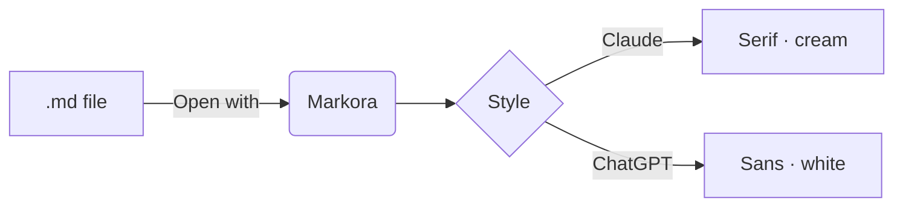

# Welcome to Markora

Markora renders Markdown the way modern AI chats do: **clean typography**, *comfortable spacing*, and code you can copy in one click. Switch between the **Claude** and **ChatGPT** styles in the top bar, and flip light or dark with the button next to it.

> Tip: install Markora from the browser's address bar, then right-click any `.md` file → **Open with → Markora**.

## What it handles

1. GitHub-flavored Markdown: tables, task lists, ~~strikethrough~~, autolinks like https://example.com
2. Syntax-highlighted code with a **Copy** button
3. Math, both $E = mc^2$ inline and display blocks
4. Mermaid diagrams
5. Frontmatter, which shows collapsed at the top

### Task list

- [x] Render Markdown beautifully
- [x] Live-reload when the file changes on disk
- [ ] Take over the world

## Code

```python
from dataclasses import dataclass

@dataclass
class Note:
    title: str
    words: int = 0

    def reading_time(self) -> float:
        """Minutes to read at 230 wpm."""
        return round(self.words / 230, 1)

print(Note("Markora", 1200).reading_time())  # 5.2
```

```ts
export async function openWith(handle: FileSystemFileHandle) {
  const file = await handle.getFile();
  return render(await file.text());
}
```

## Table

| Feature        | Claude style            | ChatGPT style         |
| -------------- | ----------------------- | --------------------- |
| Body font      | Serif, warm             | Sans-serif, neutral   |
| Background     | Paper cream / charcoal  | White / graphite      |
| Accent         | Clay                    | Ink black             |

## Math

The Gaussian integral:

$$
\int_{-\infty}^{\infty} e^{-x^2}\,dx = \sqrt{\pi}
$$

And ChatGPT-style delimiters work too: \( a^2 + b^2 = c^2 \).

## Diagram



---

Made for reading. Drop a file anywhere to begin.
